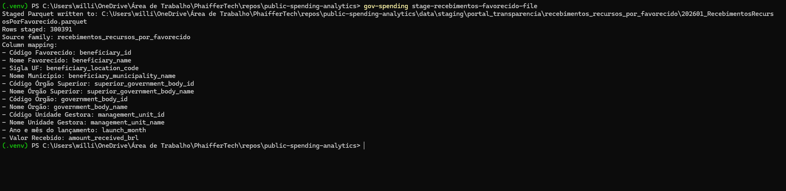
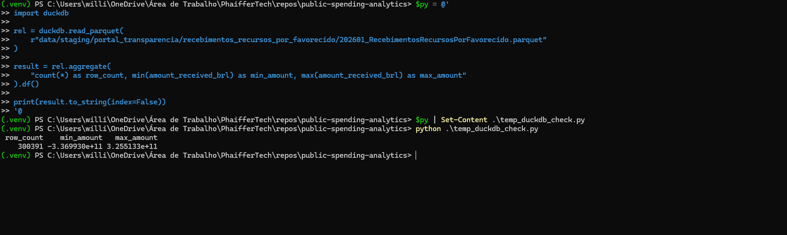
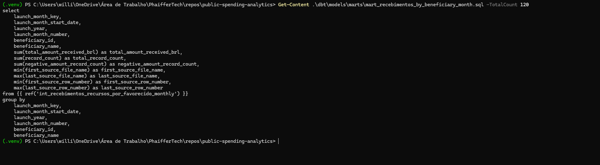

# Brazilian Federal Public Spending Analytics

[](https://github.com/phaiffer/public-spending-analytics/actions/workflows/ci.yml)

Standalone portfolio repository for building a local-first analytical foundation over Brazilian federal public spending data from official public sources.

This repository is currently centered on one real implemented analytical case
study from the Portal da Transparencia:

- `Recebimentos de Recursos por Favorecido`

It is designed as a serious local-first data engineering portfolio project:
clear scope, reproducible execution, documented trade-offs, and an honest line
between what is already implemented and what is still planned.

## Case Study Summary

This repository is currently a portfolio case study for one real implemented
source family:

- `Recebimentos de Recursos por Favorecido`

What is real in the current pipeline:

- one official raw CSV was profiled successfully
- one real staged Parquet was written
- one real dbt staging model was connected to DuckDB
- one conservative intermediate monthly model was built
- one first mart-ready monthly model was built
- `dbt build` runs end to end through the dbt CLI (48 nodes: models, seed, and data tests)

Implemented source facts from the real file:

- file: `202601_RecebimentosRecursosPorFavorecido.csv`, version retrieved on
  2026-10-21 and pinned by SHA-256 in `config/source_manifest.toml`
- profiled rows: `300350`
- profiled columns: `12`
- staged rows written: `300350`
- mart rows at beneficiary-month grain: `233654`
- negative signed amount rows observed: `1656`
- beneficiary IDs with more than one beneficiary name in the real source: `13426`,
  all of them masked CPFs (see [Beneficiary Identifier Kinds](#beneficiary-identifier-kinds))

The Portal republished this January 2026 file on 2026-10-10. An earlier,
unhashed version of the same file had `300391` rows, `1659` negative rows, and
`233666` mart rows; the screenshots and Excel samples below come from that
earlier run.

## Why This Project Matters

Brazilian federal public spending data is publicly available, but it is not always easy to use analytically. The data is large, operationally shaped, and spread across files that require careful interpretation before business questions can be answered.

This repository aims to turn official public data into transparent analytical
models without pretending the source is cleaner than it is.

The current implemented case study asks a narrower but real question:

- how can one official monthly source file about received resources be profiled,
  staged, tested, and modeled into a conservative beneficiary-month mart?

The broader repository direction is still larger than the implemented case
study:

- a future analytical foundation over the federal spending lifecycle, including
  commitment, liquidation, and payment stages

The goal is not to build a dashboard first. The goal is to build a trustworthy
data foundation and show the engineering judgment behind it.

## Business Problem

The business problem is simple to state and awkward to solve well:

How do you turn official public spending files into something analytical without
pretending the source is cleaner or more stable than it really is?

For the implemented source family, the friction is not just technical file
parsing. It is modeling discipline:

- identifiers may look numeric but should stay textual
- geography includes values such as `EX`, so a Brazil-only assumption would be wrong
- monthly fields should not be inflated into fake daily dates
- signed negative amounts are present in the real file and must not be erased
- beneficiary identifiers do not behave like a clean master key in the current data

That is why this repository favors a conservative pipeline: preserve the raw
meaning first, then add only the analytical structure that is justified by real
source evidence.

## Scope

### Current Implemented Scope

- One real Portal da Transparencia bulk CSV source:
  `Recebimentos de Recursos por Favorecido`
- Local profiling of that real source file
- Python raw-to-staging transformation into Parquet
- DuckDB + dbt staging, intermediate, and first mart-ready modeling for that
  source family
- A targeted raw API ingestion path for the constrained
  `despesas/documentos` endpoint, implemented as raw ingestion only

### Future Planned Scope

- Broader Brazilian federal public spending analytics
- Additional official bulk files from Portal da Transparencia
- Spending-lifecycle modeling across commitment, liquidation, and payment
- A future core fact table for spending amounts by date, government body,
  beneficiary, and spending stage

### Out Of Scope For The MVP

- Broad API-first ingestion across all Portal da Transparencia sources.
- State and municipal spending.
- Procurement, contracts, agreements, and transfers as the main analytical scope.
- Dashboards or BI tools.
- Cloud infrastructure.
- CI/CD.
- Airflow, Prefect, Spark, Kubernetes, Terraform, or other heavy platform tooling.

These areas may become future phases after the federal spending model is stable.

## Current Source Scope

The repository contains groundwork for more than one source family, but the
implemented analytical case study is intentionally narrower.

Current implemented path:

```text
202601_RecebimentosRecursosPorFavorecido.csv
  -> profiling JSON
  -> staged Parquet
  -> dbt staging model
  -> dbt intermediate monthly model
  -> mart_recebimentos_by_beneficiary_month
```

Other source paths in the repository, including the targeted `despesas`
endpoint work, are still partial or intentionally scaffolded compared with this
recebimentos path.

## Repository Direction

The repository has two distinct layers of ambition:

1. Current implemented case study:
   a real end-to-end analytical path for one official `recebimentos` source
2. Future repository direction:
   a broader local analytical foundation for federal spending data

The repository does not currently implement the full broader vision. The
implemented work is intentionally narrower and should be read that way.

## Current Implemented Questions

- What is the signed total amount received per beneficiary in the implemented
  month?
- Which beneficiaries have the largest positive or negative received totals?
- How many source records contribute to each beneficiary-month row?
- How often do negative signed values occur?
- How often does the same `beneficiary_id` appear with more than one
  `beneficiary_name`?

## Future Planned Questions

- Which government bodies committed, liquidated, and paid the most spending?
- Which beneficiaries received the largest payments across spending stages?
- How do spending stages compare across time?
- Where are there gaps between committed, liquidated, and paid amounts?
- Which spending patterns deserve deeper public scrutiny across the broader
  lifecycle?

## Target Users

- **Data engineering recruiters and reviewers** who want to see practical modeling, documentation, and local data pipeline design.
- **Public policy analysts** who need clear spending metrics before building analysis.
- **Civic tech practitioners** interested in reproducible use of official open data.
- **The repository owner** as a focused standalone project separate from a broader portfolio.

## Current Implemented KPIs

- **Total Amount Received**: Signed sum of `amount_received_brl` in the current
  source family.
- **Total Record Count**: Number of source-derived records represented in an
  aggregate row.
- **Negative Amount Record Count**: Number of source-derived records with signed
  negative values.
- **Beneficiary Name Collision Count**: Count of beneficiary IDs that map to
  more than one beneficiary name in the implemented source month.

## Future Planned KPIs

- **Committed Amount**: Total value formally committed by the government.
- **Liquidated Amount**: Total value recognized as delivered or payable after liquidation.
- **Paid Amount**: Total value effectively paid.
- **Payment Rate**: Paid amount divided by committed amount, where the denominator is valid.
- **Liquidation Rate**: Liquidated amount divided by committed amount, where the denominator is valid.
- **Open Commitment Amount**: Committed amount minus paid amount.
- **Beneficiary Concentration**: Share of paid amount represented by top beneficiaries.

Metric details and caveats, including future planned definitions, are
documented in [docs/metric_definitions.md](docs/metric_definitions.md).

## High-Level Architecture

```text
Official bulk CSV downloads
        |
        v
data/raw/
        |
        v
Source profiling
        |
        v
Python ingestion and normalization
        |
        v
data/staging/ as Parquet
        |
        v
DuckDB local analytical database
        |
        v
dbt models
  - staging
  - intermediate
  - marts
        |
        v
data/curated/ and analytical tables
```

The architecture is intentionally simple. Python handles file discovery, configuration, and normalization tasks. DuckDB provides fast local analytics. dbt provides SQL modeling structure, tests, and documentation conventions.

## Implemented Flow

For the current case study, the implemented architectural flow is:

```text
Official CSV
  202601_RecebimentosRecursosPorFavorecido.csv
        |
        v
Profiling artifact
  profiling/202601_RecebimentosRecursosPorFavorecido_profile.json
        |
        v
Python raw-to-staging transformation
        |
        v
Staged Parquet
  data/staging/portal_transparencia/recebimentos_recursos_por_favorecido/
        |
        v
DuckDB external source in dbt
        |
        v
dbt staging model
  stg_portal_transparencia__recebimentos_recursos_por_favorecido
        |
        v
dbt intermediate model
  int_recebimentos_recursos_por_favorecido_monthly
        |
        v
dbt mart
  mart_recebimentos_by_beneficiary_month
```

That is the implemented pipeline today. It is deliberately local-first and does
not depend on orchestration, cloud services, or dashboard infrastructure.

## Pipeline Evidence

Staging command success



DuckDB validation over the staged Parquet



Mart-layer SQL preview



The repository includes evidence across the raw-source, profiling, staged
Parquet, and mart SQL layers, with the strongest pipeline checkpoints shown
here. These screenshots were captured on the earlier `300391`-row version of
the source file.

`dbt build` result against the registered `300350`-row version (2026-10-21):

```text
Finished running 1 seed, 2 table models, 43 data tests, 2 view models
Done. PASS=48 WARN=0 ERROR=0 SKIP=0 NO-OP=0 REUSED=0 TOTAL=48
```

## Intended Analytical Model

The MVP is designed around a future `fact_public_spending` table.

Likely fact grain:

- one row per normalized spending event or spending document line, depending on source file availability and deduplication rules
- associated spending stage: commitment, liquidation, or payment
- amount in Brazilian reais
- document identifiers retained for traceability

Likely dimensions:

- `dim_date`
- `dim_government_body`
- `dim_beneficiary`
- `dim_spending_stage`

The exact grain will be finalized after profiling real downloaded files.

## Roadmap

### Phase 1: Repository Foundation

- Define project identity, scope, and architecture.
- Create Python package structure.
- Prepare dbt + DuckDB project structure.
- Document sources, metrics, and assumptions.
- Create local data folder conventions.

### Phase 2: Ingestion MVP

- Download a small sample period manually from Portal da Transparencia.
- Implement local CSV discovery and schema inspection.
- Normalize selected spending files into Parquet.
- Add basic data quality checks.

### Phase 3: dbt Modeling MVP

- Build staging models for selected spending files.
- Create intermediate models for spending-stage unification.
- Create the first spending mart.
- Add dbt tests for keys, accepted values, and amount sanity checks.

### Phase 4: Analytical Outputs

- Add reproducible example queries.
- Add portfolio-ready analysis notebooks or static reports.
- Document findings and limitations.

### Phase 5: Expansion

- Add more years and source file types.
- Consider contracts, procurement, transfers, or subnational data.
- Evaluate dashboarding only after the model is stable.

## What This Repository Proves

From a data engineering perspective, this repository is intended to demonstrate:

- pragmatic source selection from official public data
- local-first batch pipeline design
- clear separation of raw, staging, and curated data
- analytical modeling with fact and dimension thinking
- DuckDB usage for local analytics
- dbt project organization without premature platform complexity
- metric definition discipline
- honest documentation of assumptions and deferred work

## Modeling Layers

The implemented `recebimentos` path currently has four meaningful layers:

1. Raw:
   the original official CSV, preserved exactly as downloaded
2. Staging:
   one row per raw CSV row, typed and traceable, with no business-heavy reshaping
3. Intermediate:
   a conservative monthly aggregation that still keeps organizational and geographic detail
4. Mart:
   a beneficiary-month table intended for analysis, not for source reconstruction

This shape is deliberate. It lets the repository show analytical progress
without collapsing unresolved source issues too early.

## Key Trade-Offs

The most important trade-offs are not flashy. They are the ones that stop the
model from lying.

`beneficiary_id` remains text:
- the real source presents identifier-looking values that should not be coerced into integers
- the project does not assume the field is always a CNPJ

Geography remains flexible:
- `beneficiary_location_code` is preserved as provided
- values such as `EX` are treated as valid source evidence, not data quality failures

Negative amounts are preserved:
- the real staged file contains `1656` negative signed amount rows
- forcing a non-negative rule here would destroy observed source behavior

`beneficiary_name` remains in the mart grain:
- in the current real source, `13426` beneficiary IDs map to more than one beneficiary name
- every one of them is a masked CPF, which the Portal publishes with only six digits visible
- collapsing the mart to month + `beneficiary_id` would merge different people into one row

`source_row_number` is only scoped within `source_file_name`:
- that is safe for the implemented file
- it is not advertised as a future global key across all files and months

## Negative Amounts

Negative amounts are not treated as noise in this repository.

In the implemented `Recebimentos de Recursos por Favorecido` file:

- `1656` rows contain negative signed amounts

The pipeline therefore keeps `amount_received_brl` signed through staging,
intermediate, and mart layers. The current implementation does not claim a full
business interpretation for every negative value. It only makes the narrower
and safer claim that the source contains them and the analytical model should
preserve them.

## Why `beneficiary_name` Stays In The Mart Grain

This is the most important modeling choice in the current case study.

The first mart is:

```text
mart_recebimentos_by_beneficiary_month
```

Its grain is one row per:

- `launch_month_key`
- `beneficiary_id`
- `beneficiary_name`

`beneficiary_name` is not kept there for decoration. It is part of the grain
because the real data shows that `beneficiary_id` alone is not stable enough
for a beneficiary-level mart. In the implemented file, multiple names can
appear under the same beneficiary ID.

The cause is now confirmed: all `13426` multi-name IDs are masked CPFs such as
`***.123.456-**`. The Portal hides the first three and last two digits of
individual taxpayers' CPFs, so different people can share one masked value.
No CNPJ (14-digit) identifier has more than one name in this file. The masked
value plus the name is the best identity the public source offers for
individuals, and it is still not a guaranteed unique person.

## Beneficiary Identifier Kinds

`beneficiary_identifier_kind` is derived in the dbt staging model from the
shape of `beneficiary_id` and carried through the intermediate and mart
layers. It does not change any grain, because it depends only on
`beneficiary_id`. Counts below are for the registered `300350`-row version:

| Kind | Rule | Rows | Distinct IDs | Multi-name IDs |
| --- | --- | ---: | ---: | ---: |
| `cpf_masked` | `***.NNN.NNN-**` | 159943 | 144309 | 13426 |
| `cnpj` | 14 digits | 135383 | 71570 | 0 |
| `foreign_code` | `EX` + 7 characters (2508 of 2526 rows have location `EX`) | 2526 | 2466 | 0 |
| `other_code` | anything else: mostly 6-digit codes that also appear as management unit IDs, plus `RB`/`TN`/`PF` codes | 1584 | 694 | 0 |
| `placeholder` | negative codes: `-1` SEM INFORMACAO, `-9` NAO SE APLICA, `-11` Sigiloso, `-13` FOLHA DE PAGAMENTO | 914 | 4 | 0 |

`placeholder` IDs are not beneficiaries; they label rows where the beneficiary
is unknown, not applicable, confidential, or a payroll aggregate. Exclude them
from beneficiary rankings. The dbt test
`assert_mart_recebimentos_multi_name_ids_are_masked_cpf` warns if any
non-`cpf_masked` identifier starts showing name collisions in a future file.

## Key Findings

The current case study supports a few concrete observations from the real
implemented source:

- the source is analytically usable, but only after careful typing and monthly normalization
- beneficiary identity is not fully stable at the ID-only level, and the
  instability comes entirely from masked CPFs; CNPJ identifiers are stable
- placeholder IDs (`-1`, `-9`, `-11`, `-13`) concentrate rows that have no
  identifiable beneficiary and must be excluded from beneficiary rankings
- negative signed amounts are part of the real source behavior
- a conservative mart can still be built without inventing unsupported business logic

These are modest findings on purpose. They are grounded in the implemented
pipeline rather than in a polished narrative detached from the data.

## Analytical Examples

The current mart supports straightforward monthly beneficiary analysis. Example
queries below assume the mart model has been built in DuckDB/dbt.

Top beneficiaries by signed monthly amount, excluding placeholder IDs:

```sql
select
    launch_month_key,
    beneficiary_id,
    beneficiary_identifier_kind,
    beneficiary_name,
    total_amount_received_brl
from mart_recebimentos_by_beneficiary_month
where beneficiary_identifier_kind != 'placeholder'
order by total_amount_received_brl desc
limit 20;
```

Beneficiaries with the most negative records:

```sql
select
    launch_month_key,
    beneficiary_id,
    beneficiary_name,
    negative_amount_record_count,
    total_record_count,
    total_amount_received_brl
from mart_recebimentos_by_beneficiary_month
where negative_amount_record_count > 0
order by negative_amount_record_count desc, total_amount_received_brl asc;
```

Total received amount by month:

```sql
select
    launch_month_key,
    launch_month_start_date,
    sum(total_amount_received_brl) as month_total_amount_received_brl,
    sum(total_record_count) as month_total_record_count
from mart_recebimentos_by_beneficiary_month
group by 1, 2
order by 1;
```

Beneficiary-name collisions under the same beneficiary ID:

```sql
select
    launch_month_key,
    beneficiary_id,
    beneficiary_identifier_kind,
    count(distinct beneficiary_name) as distinct_name_count
from mart_recebimentos_by_beneficiary_month
group by 1, 2, 3
having count(distinct beneficiary_name) > 1
order by distinct_name_count desc, beneficiary_id;
```

Largest management-unit totals from the intermediate layer:

```sql
select
    launch_month_key,
    management_unit_id,
    management_unit_name,
    sum(total_amount_received_brl) as total_amount_received_brl,
    sum(record_count) as total_record_count
from int_recebimentos_recursos_por_favorecido_monthly
group by 1, 2, 3
order by total_amount_received_brl desc
limit 20;
```

## Getting Started

This foundation does not require real data to install.

Supported Python versions: 3.11 to 3.13 (`.python-version` pins 3.12). Python
3.14 is excluded because the dbt CLI (`dbt-duckdb`) failed to import on it.

Recommended setup with [uv](https://docs.astral.sh/uv/), which installs the
exact dependency versions recorded in `uv.lock`:

```bash
uv sync --extra dev --extra dashboard
source .venv/bin/activate
```

The `dashboard` extra (Streamlit) is only needed for `gov-spending dashboard`.

Without uv, a plain virtual environment also works, but resolves dependency
versions at install time instead of using the lock file:

```bash
python3.12 -m venv .venv
source .venv/bin/activate
python -m pip install -e ".[dev]"
```

On Windows PowerShell, activate with `.\.venv\Scripts\Activate.ps1` instead.

Check the CLI:

```bash
gov-spending --help
```

Create a local DuckDB database placeholder:

```bash
gov-spending bootstrap-duckdb
```

## Source Profiling Workflow

This repository does not download Portal da Transparencia files automatically. Download one official spending CSV manually and keep the original file name.

Recommended folder pattern:

```bash
mkdir -p data/raw/portal_transparencia/despesas/2025/01
```

Place one downloaded file under that folder, for example:

```text
data/raw/portal_transparencia/despesas/2025/01/20250101_Despesas_Pagamento.csv
```

List discovered raw CSV files:

```bash
gov-spending list-raw-files
```

Profile one selected file:

```bash
gov-spending profile-raw-file --file data/raw/portal_transparencia/despesas/2025/01/20250101_Despesas_Pagamento.csv
```

Or select by a filename substring when exactly one file matches:

```bash
gov-spending profile-raw-file --pattern Pagamento
```

The profiling command writes a JSON summary under `profiling/` by default. The output includes:

- detected encoding and delimiter
- row count
- source columns
- normalized column names
- sample records
- sample-based type inference
- null-heavy columns
- heuristic canonical column suggestions

Profiling outputs may include sampled public records, so generated JSON files are ignored by git by default. Review them before deciding whether to publish a summarized version.

## Experimental: API Despesas Documentos Ingestion Workflow

> **Experimental.** The `Despesas` paths (this API ingestion and the CSV
> staging below) are not part of the implemented case study. They have not
> been run end to end against a real downloaded file in this repository, no
> enabled dbt model reads their output, and they are not covered by the CI
> pipeline test. Treat their behavior as provisional.

The project supports a narrow official API extraction path for raw Portal da
Transparencia `despesas/documentos` responses. This is local-first raw
ingestion: responses are stored as JSON exactly as returned by the API, and no
staging, normalization, dbt modeling, or mart logic is applied in this step.

The official API documentation confirms the despesas documents endpoint:

```text
GET https://api.portaldatransparencia.gov.br/api-de-dados/despesas/documentos
```

Confirmed documented query parameters for this endpoint:

- `dataEmissao`: issue date in `DD/MM/YYYY`
- `fase`: spending phase code, where `1` is empenho, `2` is liquidacao, and `3` is pagamento
- `pagina`: page number
- optional filters: `unidadeGestora` and `gestao`

Observed endpoint constraints:

- `dataEmissao`, `fase`, and `pagina` are required
- the request period is limited to one day
- at least one additional filter is required, such as `unidadeGestora` or `gestao`

Configure an API key by registering at the Portal da Transparencia API page and
setting the environment variable named in `config/project.toml`:

```bash
export PORTAL_TRANSPARENCIA_API_KEY="<your-api-key>"
```

Run a narrow extraction:

```bash
gov-spending ingest-despesas-documentos \
  --data-emissao 02/01/2025 \
  --fase 3 \
  --unidade-gestora <VALUE>
```

Default raw output pattern:

```text
data/raw/portal_transparencia_api/despesas_documentos/data_emissao=2025-01-02/fase=3/unidade_gestora=<VALUE>/
```

The extraction writes one raw JSON file per non-empty API page, such as:

```text
page=0001.json
```

It also writes `manifest.json` with request parameters, extraction timestamps,
page count, record count, source endpoint, and the persisted raw files.

What remains provisional:

- raw API response fields are not treated as stable canonical fields yet
- API raw JSON has not replaced the bulk CSV profiling/staging path
- large extractions should still prefer official bulk open-data files, as the Portal documentation recommends
- the first API path covers only `despesas/documentos`, not every Portal da Transparencia endpoint
- valid `unidadeGestora` and `gestao` values must come from official/source context before live extraction

## Experimental: Despesas CSV Staging Workflow

> **Experimental.** The `Despesas` paths (this API ingestion and the CSV
> staging below) are not part of the implemented case study. They have not
> been run end to end against a real downloaded file in this repository, no
> enabled dbt model reads their output, and they are not covered by the CI
> pipeline test. Treat their behavior as provisional.

> Known risk: this path rejects negative `amount_brl` values. The implemented
> recebimentos source contains real negative amounts (`1656` rows), so a real
> `Despesas` file with reversals may fail staging. Revisit that rule with a real
> profile before relying on this path.

The first staging command is limited to one Portal da Transparencia `Despesas` CSV and its matching profile artifact. It validates that the raw CSV header still matches the profiled columns before writing Parquet.

Run profiling first:

```bash
gov-spending profile-raw-file --file data/raw/portal_transparencia/despesas/2025/01/20250101_Despesas_Pagamento.csv
```

Then stage that same file:

```bash
gov-spending stage-despesas-file --file data/raw/portal_transparencia/despesas/2025/01/20250101_Despesas_Pagamento.csv
```

If the profile artifact is stored somewhere else, pass it explicitly:

```bash
gov-spending stage-despesas-file \
  --file data/raw/portal_transparencia/despesas/2025/01/20250101_Despesas_Pagamento.csv \
  --profile profiling/20250101_Despesas_Pagamento_profile.json
```

Default output pattern:

```text
data/staging/portal_transparencia/despesas/<spending_stage>/<source file stem>.parquet
```

Current staging grain:

- one staged row per raw CSV data row from the selected official file
- original source columns are preserved with `source__` prefixes after ASCII snake-case normalization
- source metadata is retained, including source file name, profile artifact name, source row number, source family, and spending stage
- canonical fields are populated only when the profile artifact produced one unambiguous source-column mapping

The command currently requires an unambiguous profile-based mapping for:

- `amount_brl`

The command may also populate optional canonical fields when they are unambiguous in the profile:

- `spending_document_id`
- `spending_date`
- `fiscal_year`
- `government_body_id`
- `government_body_name`
- `beneficiary_id`
- `beneficiary_name`

`spending_document_id` is provisional at the staging layer. Real Portal da Transparencia
`Despesas` files can expose more than one plausible document identifier, so staging keeps
all observed source columns and only emits this canonical field when the profile has one
clear source column. `amount_brl` remains required because the first staged spending path
is not useful without a parsed monetary value.

Before writing Parquet, staging now runs lightweight checks tied to the observed profile
and staged output:

- required staged columns exist and are populated
- `amount_brl` values are non-negative (provisional; see the known risk above)
- source traceability fields exist and are populated
- `source_row_number` remains positive

The spending stage is inferred from the official `Despesas` file name family, such as `Despesas_Empenho`, `Despesas_Liquidacao`, or `Despesas_Pagamento`.

## Recebimentos Por Favorecido Staging Workflow

The first confirmed non-`Despesas` raw-to-staging path uses the official file:

```text
data/raw/202601_RecebimentosRecursosPorFavorecido.csv
```

Confirmed profile facts:

- encoding: `latin-1`
- delimiter: semicolon
- row count: `300350` (registered version; see `config/source_manifest.toml`)
- column count: `12`
- no null-heavy columns detected in the profiled sample

Download it from the official page, which redirects to a ZIP containing only
this CSV:

```text
https://portaldatransparencia.gov.br/download-de-dados/despesas-favorecidos/202601
```

The exact file version is registered in `config/source_manifest.toml` by
SHA-256, together with its size, row count, archive URL, and retrieval date.
Staging hashes the raw file and refuses it unless the name and hash match a
registered entry, and the expected row count comes from that entry. The Portal
does republish past months (the January 2026 archive was republished on
2026-10-10), so a new download may need to be registered before it can be
staged.

Run staging:

```bash
gov-spending stage-recebimentos-favorecido-file
```

Default output:

```text
data/staging/portal_transparencia/recebimentos_recursos_por_favorecido/202601_RecebimentosRecursosPorFavorecido.parquet
```

Current staging grain:

- one staged row per raw CSV row
- no aggregation, deduplication, or beneficiary classification
- source file name, source path, profile name, and source row number retained
- `Código Favorecido` is staged as text, not an integer
- `Sigla UF` is staged as a location code and may include values such as `EX`
- `Ano e mês do lançamento` is staged as a monthly `YYYY-MM` key
- `Valor Recebido` is parsed as `amount_received_brl`

The full staged file currently contains negative `amount_received_brl` values, so
this source does not enforce a non-negative amount check at staging time.

## Recebimentos dbt Staging Model

The staged Parquet is registered in dbt as an external DuckDB source:

```text
source('portal_transparencia_staging_files', 'recebimentos_recursos_por_favorecido')
```

The first real dbt model for this source is:

```text
stg_portal_transparencia__recebimentos_recursos_por_favorecido
```

This model remains source-aligned and traceable. It keeps `launch_month` as the
staged monthly value and adds conservative analytical helpers:

- `launch_month_key`: integer `YYYYMM`
- `launch_month_start_date`: first day of the month, for date joins
- `launch_year`
- `launch_month_number`

`amount_received_brl` remains signed because negative values were observed in
the real staged output. `beneficiary_id` remains text and geography remains
flexible; `EX` / exterior values are not filtered or remapped.

The first intermediate model above staging is:

```text
int_recebimentos_recursos_por_favorecido_monthly
```

Its grain is one row per month, beneficiary, government body, management unit,
beneficiary location code, and beneficiary municipality name. It produces:

- `total_amount_received_brl`
- `record_count`
- `negative_amount_record_count`

The model keeps signed amounts and does not classify beneficiary type. It also
keeps source row-number bounds and source file name bounds for traceability.
`source_row_number` should be understood as unique within `source_file_name`,
not as a future global key across every source file.

The first mart-ready model above that intermediate layer is:

```text
mart_recebimentos_by_beneficiary_month
```

Its grain is one row per month, `beneficiary_id`, and `beneficiary_name`.
Organizational and geographic fields are intentionally not part of the mart
grain in this first version; they remain available in the intermediate layer.

`beneficiary_name` remains in the mart grain because the real data shows that
`beneficiary_id` alone is not stable enough for beneficiary-level aggregation.
In the current source, multiple names can appear under the same
`beneficiary_id`, so collapsing to month + ID would merge distinct beneficiary
labels too aggressively.

The mart includes:

- `total_amount_received_brl`
- `total_record_count`
- `negative_amount_record_count`

The mart keeps signed amounts and exposes source file and source row-number
bounds for traceability back to the intermediate and staging layers.

## Running dbt

dbt runs from the `dbt/` folder against the DuckDB file under `data/curated/`.
Stage the raw file first, then:

```bash
cp dbt/profiles.yml.example dbt/profiles.yml
cd dbt
dbt build --profiles-dir .
```

`dbt build` loads the seed, builds the staging and intermediate views and the
mart tables, and runs every data test. The project var
`recebimentos_staged_parquet` controls the input. It defaults to a glob that
reads every staged month under
`data/staging/portal_transparencia/recebimentos_recursos_por_favorecido/`;
override it with `--vars` to build against another file or glob.

Each staged row carries `source_registered_row_count`, the row count registered
for its file version in the source manifest. The
`assert_recebimentos_source_row_count` test checks every staged file against
it, so no month can lose or gain rows between the manifest and the mart. A
warn-level test also flags any file whose launch months differ from the month
in its file name.

## Keeping The Data Current

The Portal publishes one archive per month (`YYYYMM_Despesas.zip`, holding a
single `YYYYMM_RecebimentosRecursosPorFavorecido.csv`) from 2013-12 onward. It
updates the current month every day and republishes past months without notice
(on 2026-10-22 the server reported that day's date for 2026-02 through 2026-10
and also for older months such as 2016-12 and 2020-04). There is no delay after which a month is
final, so the sync job detects changes instead of waiting a fixed period:

```bash
gov-spending sync-recebimentos --dry-run          # report what changed, download nothing
gov-spending sync-recebimentos --dbt-build        # current month + the 12 before it
gov-spending sync-recebimentos --all --dbt-build  # every month since 2013-12
gov-spending sync-recebimentos --since 2024-01 --until 2024-12
```

For each month it:

1. asks the server for `Last-Modified` and size (HEAD) and skips the month when
   both match the last run and the month is already staged
2. downloads the archive into a new folder,
   `data/raw/portal_transparencia/recebimentos_recursos_por_favorecido/YYYYMM/<UTC timestamp>/`,
   and refuses it unless it holds exactly the expected CSV within a size limit
3. hashes the CSV; when the content is unchanged it keeps the staged month and
   deletes the new folder
4. otherwise profiles the CSV, stages it against a one-entry manifest next to the
   download, and only then appends the version to
   `data/sync/recebimentos_source_manifest.toml`
5. replaces `data/staging/.../YYYYMM_RecebimentosRecursosPorFavorecido.parquet`
   atomically and deletes the extracted CSV (`--keep-csv` keeps it); the archive
   and profile stay as the record of that version

Each month prints one status: `missing`, `unchanged`, `same_content`, `staged`,
`would_download`, `failed` (retried next run), or `blocked`. A month registered
while it was still the current month is flagged `is_open_month = true`.

The reviewed `config/source_manifest.toml` stays the pinned reference for the
documented January 2026 results; the sync manifest under `data/` is machine
written and not committed. Republished versions are kept side by side, so a
changed month can always be compared with the version it replaced.

**Rate limits.** The download server sits behind an AWS WAF. The first
full-history run (about 170 HEAD requests in a few minutes) was answered with
HTTP 405 and `x-amzn-waf-action: captcha` for every request. Sync therefore
waits `--request-interval` seconds between months (3 by default), checks only
the recent window by default, treats a WAF challenge or HTTP 429 as `blocked`,
and stops the run instead of retrying. It does not try to get around the
challenge; wait a few hours and run again.

**Restaging without downloading.** After a staging change, rebuild every synced
month from the archives already on disk; the CSV must still match its registered
SHA-256:

```bash
gov-spending restage-recebimentos --dbt-build
```

**Scheduling.** On Linux, install systemd user timers that run the recent-window
sync daily at 06:00 and a full `--all` sweep on Sundays at 07:00, each followed
by `dbt build`:

```bash
scripts/install_sync_timer.sh
journalctl --user -u gov-spending-sync.service -u gov-spending-sync-full.service
```

The Portal regenerates its archives shortly after 00:00 UTC (about 21:00 in
Brasilia), so morning runs pick up the previous evening's files. An advisory
lock keeps a manual run and a scheduled run from syncing at the same time.

A full history download is about 3 GB of archives; staging takes roughly a
minute per month on a desktop machine, so `--all` from scratch runs for a few
hours.

## Dashboard

```bash
gov-spending dashboard            # http://localhost:8501
```

A Streamlit page over the dbt marts, in Brazilian Portuguese for the public
audience:

- period slider over the months loaded, superior government body filter, and
  beneficiary identifier kind filter
- total received, record count, negative records, and months with data
- monthly totals on a time axis: months not loaded locally show as gaps, and a
  month registered while still open is drawn lighter and labelled partial
- rankings by superior government body and by identifier kind
- the largest CNPJ and foreign beneficiaries in the period; masked CPFs are people
  and are never ranked

Charts read `mart_recebimentos_monthly_summary`, a rollup of month x superior
body x identifier kind that stays small over the full history. Queries use
short-lived read-only DuckDB connections, so the scheduled sync can rebuild the
database while the page is open. The page binds to `localhost`; publishing it
is a separate deployment decision. The light and dark themes follow the viewer.

## End-To-End Test On A Synthetic Sample

The real source file is not committed, so the full pipeline is also exercised
on a 16-row synthetic sample:

```text
tests/fixtures/recebimentos_sample/202601_RecebimentosRecursosPorFavorecido.csv
```

It keeps the official format (latin-1, semicolon delimiter, quoted fields,
CRLF line endings, `MM/YYYY` months, Brazilian decimals) and covers every
beneficiary identifier kind, negative amounts, an `EX` / exterior beneficiary,
and one masked-CPF name collision. Beneficiary names and identifiers are
fictitious. It is pinned by its own manifest, `tests/fixtures/source_manifest.toml`,
and regenerated with `tests/fixtures/make_recebimentos_sample.py`.

`tests/test_recebimentos_e2e.py` profiles the sample, stages it, runs
`dbt build` into a temporary DuckDB file, and checks the identifier kinds,
mart row count, and collision result:

```bash
pytest tests/test_recebimentos_e2e.py
```

GitHub Actions (`.github/workflows/ci.yml`) runs `ruff check`, the full pytest
suite, and therefore this sample `dbt build`, on Python 3.11, 3.12, and 3.13
with the dependency versions locked in `uv.lock`.

## Limitations And Future Work

Current limitations are explicit:

- the documented results, screenshots, and Excel samples cover January 2026 only;
  the pipeline now loads any number of months, but the case study has not been
  rewritten over the full history
- `sync-recebimentos --all` needs several polite runs to fetch the full history
  when the Portal's WAF challenges the machine
- the dbt CLI does not run on Python 3.14 (upstream import error in `dbt-duckdb`), so the project is pinned to Python 3.11-3.13
- `beneficiary_id` is not yet a reliable beneficiary master key
- beneficiary type classification is intentionally deferred
- organizational and geographic attributes are not part of the first mart grain
- the repository does not yet provide a broad multi-source unified spending mart

Reasonable next steps, without changing the project character:

- rewrite the case study over the full synced history
- with four months loaded, 139 CNPJ and other-code IDs carry more than one name
  across months (renamed companies) and none within a month; track whether that
  holds over the full history
- decide whether a separate beneficiary reference layer is justified by repeated evidence
- extend the same conservative pattern to additional official source families

## Official Source Starting Point

The initial source strategy is based on the Portal da Transparencia open data download area, especially the public spending files listed under "Despesas publicas", including "Documentos de empenho, liquidacao e pagamento" and "Execucao da despesa". See [docs/source_catalog.md](docs/source_catalog.md) for details and source links checked during repository creation.

Current profiling status in git-tracked documentation: no real raw CSV file or profile artifact is committed because raw data and local profiles are ignored. The staging implementation reads the ignored local profile artifact and uses only columns present in that artifact's `columns` list. Run `gov-spending profile-raw-file` after placing a manually downloaded file under `data/raw/`, then run `gov-spending stage-despesas-file` against the same file.

## Analytical Output Samples

Supplementary analytical output examples for the current implemented case study
are included as supporting material.

- Excel workbook: [docs/assets/outputs/public_spending_case_outputs.xlsx](docs/assets/outputs/public_spending_case_outputs.xlsx)
- Supporting Excel screenshots: [docs/assets/screenshots/excel/](docs/assets/screenshots/excel/)

## License

The code and documentation in this repository are released under the
[MIT License](LICENSE), Copyright (c) 2026 PhaifferTech.

The source data is not part of this repository. It is published by the
Controladoria-Geral da Uniao through the Portal da Transparencia and remains
subject to that portal's own terms of use.
